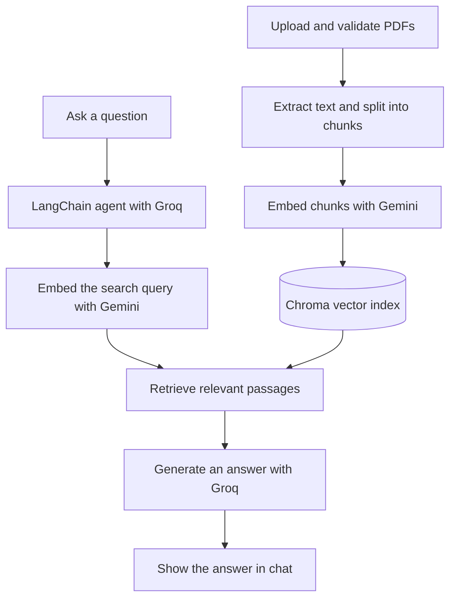

# Ask My Docs

Ask My Docs is a Streamlit app for asking questions about your PDFs. Upload one or more files, let the app index them, and ask questions in chat. The assistant looks up relevant passages and answers from the context it finds.

## What’s included

- **PDF upload and validation.** Accepts multiple PDFs and checks their size and file signature before processing.
- **Document indexing and search.** Unstructured extracts text from PDFs, LangChain splits it into chunks, Gemini creates embeddings, and Chroma stores and searches the vectors.
- **Document-grounded chat.** A LangChain agent retrieves relevant passages and uses Groq to generate answers. Chat history is kept for the current Streamlit session.
- **Duplicate submission protection.** The processing button is disabled while a run is active, and the server prevents concurrent processing in the same session.
- **Provider error handling.** Chat and PDF processing show clear messages when Gemini or Groq reaches its usage limit or returns a temporary service error.
- **Viewer toolbar.** The app hides Streamlit’s Deploy button and other developer controls.

## How it works



<details>
<summary>Plain-text workflow</summary>

```text
PDFs → Validate → Extract and chunk text → Gemini embeddings → Chroma index
Question → LangChain agent → Gemini query embedding → Search Chroma
         → Retrieved passages → Groq answer → Chat
```

</details>

## Run locally

You’ll need Python 3.12 or newer, uv, a Gemini API key, and a Groq API key. Run the following from the repository root.

```sh
uv sync --locked
cp -n .env.example .env
```

Set these values in `.env`.

| Variable | Used for |
| --- | --- |
| `GOOGLE_API_KEY` | Gemini embeddings for indexing documents and searching them |
| `GROQ_API_KEY` | Groq model for generating chat answers |

Start the app.

```sh
uv run --locked streamlit run app.py
```

## Use the app

1. Upload one or more PDFs of up to 20 MB each. Your Streamlit server may enforce a lower upload limit.
2. Select **Process Documents**. The button is disabled while processing to prevent duplicate submissions.
3. Ask a question about the PDFs. Select **Upload New Documents** to start a fresh conversation with a different set of files.

If a provider reaches its usage limit or is temporarily unavailable, the app displays a message asking you to try again later. After a processing failure, select **Process Documents** again. After a chat failure, resubmit your question. If usage-limit messages persist, check the Gemini and Groq quotas for the configured keys.

## Deployment and data

- In Streamlit Community Cloud, add `GOOGLE_API_KEY` and `GROQ_API_KEY` as top-level TOML entries in **App settings → Secrets**. The app checks Streamlit Secrets first, then environment variables, then the local `.env` file.

  ```toml
  GOOGLE_API_KEY = "your-gemini-api-key"
  GROQ_API_KEY = "your-groq-api-key"
  ```

  Keep real keys in Secrets or an ignored local file.
- The app saves uploaded PDFs under `data/uploads/` and Chroma indexes under `data/chroma_db/`. The server needs write access to these directories. Keep runtime data out of version control and manage its retention on the host.
- Document chunks are sent to Gemini for embedding. Retrieved excerpts can be sent to Groq as context for answering questions.
- Streamlit loads viewer toolbar mode from `.streamlit/config.toml`.
